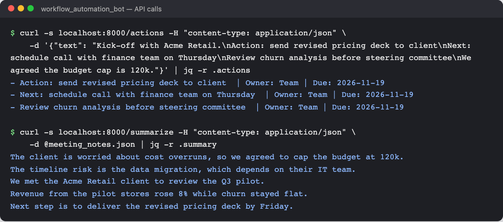
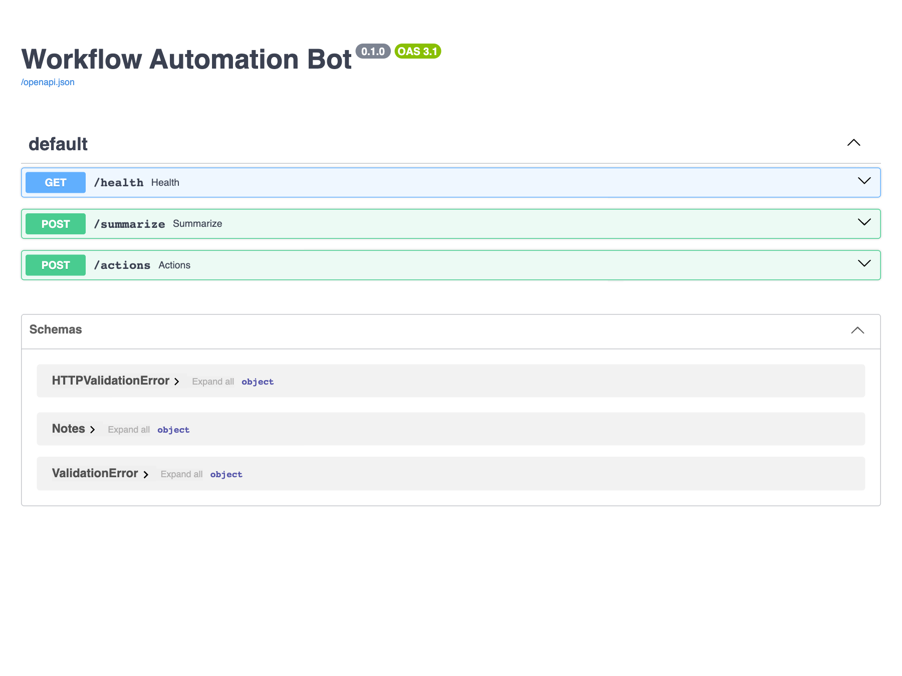

# Workflow Automation Bot


FastAPI service that converts messy consulting meeting notes into a **crisp executive summary** and a **structured action plan**.  
Optionally uses OpenAI (if `OPENAI_API_KEY` is set); otherwise falls back to a rule-based approach.

## Demo

Real responses from the running service (`uvicorn app.main:app`). `/actions` turns raw meeting notes into owned,
dated action items; `/summarize` returns the key sentences (or an LLM summary when `OPENAI_API_KEY` is set).



Interactive OpenAPI docs at `/docs`:



## Features
- `POST /summarize` → 5-bullet executive summary
- `POST /actions`   → action items with owners + default deadlines
- `GET /health`     → health check
- Dockerized, CI-enabled, with tests and devcontainer

## Quickstart (Local)
```bash
python -m venv .venv && source .venv/bin/activate   # Windows: .venv\Scripts\activate
pip install -r requirements.txt
uvicorn app.main:app --reload --port 8000
```

## With Docker
```bash
docker build -t workflow_automation_bot:latest .
docker run -p 8000:8000 workflow_automation_bot:latest
```

## With docker-compose
```bash
# optionally: export OPENAI_API_KEY=sk-...
docker-compose up --build
```

## Dev Container (VS Code)
Open folder in VS Code → `Reopen in Container`. Ports 8000 forwarded automatically.

## API
- **POST /summarize**
```bash
curl -X POST http://127.0.0.1:8000/summarize \
  -H "Content-Type: application/json" \
  -d '{ "text": "Action: send deck. We discussed budget and timeline..." }'
```
- **POST /actions**
```bash
curl -X POST http://127.0.0.1:8000/actions \
  -H "Content-Type: application/json" \
  -d '{ "text": "Action: send deck to client\nNext: schedule call" }'
```

## Tests & Lint
```bash
make test
make lint
```

## Architecture
See `docs/architecture.png`.
